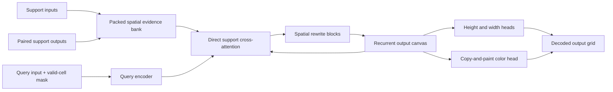
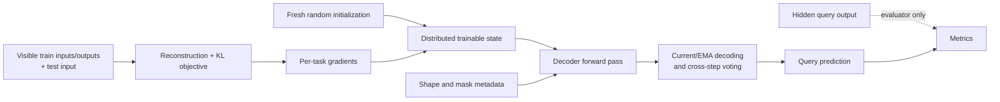

# VRM + CompressARC Audits for ARC-AGI-2

<p align="center">
  <strong>Support-conditioned grid rewriting, per-task neural compression, and causal audits of what the models actually use.</strong>
</p>

<p align="center">
  
  
  
  
</p>

---

## TL;DR

This repository contains two connected ARC-AGI-2 research lines:

1. **VRM V1.1** — a recurrent direct-grid model that repeatedly rewrites a spatial output canvas while cross-attending to packed support-pair evidence.
2. **R6A / CompressARC audit** — a source-grounded and behaviorally controlled study of how a per-task neural compression system uses support correspondence.

The central question is not merely whether a model can fit ARC grids. It is:

> **Does the model use the relation between each support input and its paired output to construct the hidden query output?**

The current evidence is mixed and deliberately reported without upgrading it into a solver or reasoning claim:

- VRM V1.1 acquired substantial **training-task output-shape capacity**, but solved **0 unseen episodes exactly**.
- Counterfactual ablations detected **support-path dependence on training tasks**, but did **not detect support-mapping use on unseen tasks**.
- The frozen CompressARC pairing assay produced a **pairing-sensitive query signal** under the declared local protocol.
- A bounded ten-task CompressARC readout produced **3/10 exact full-grid solves**.
- The internal causal carrier of the pairing-sensitive behavior remains unresolved.

---

## Headline results

| Research line | Protocol | Main result | Claim boundary |
|---|---|---:|---|
| **VRM V1.1 capacity probe** | 1,500 optimizer steps; 50 training tasks and 50 unseen tasks | Train shape match **93.59%**, train exact **4.49%**; unseen shape match **18.75%**, unseen exact **0.00%** | Capacity signal, not ARC generalization |
| **VRM support ablation** | Evaluation-only counterfactuals on the frozen checkpoint | Train: `SUPPORT_PATH_USE_ONLY`; unseen: `SUPPORT_MAPPING_USE_NOT_DETECTED` | Direct access to support evidence did not establish transferable correspondence use |
| **R6A Phase 1 pairing audit** | Frozen initialization; FULL versus all-pairing-swap conditions; target-isolated evaluator | Final verdict: `PAIRING_SENSITIVE_QUERY_PILOT` | Behavioral sensitivity, not proof of reasoning or a specific latent rule |
| **R6A exact-solve readout** | Fixed ten-task, protocol-valid FULL-condition readout | **3/10 exact full-grid solves** | Bounded readout only; not a benchmark score |
| **R6A Phase 2 localization** | Role-preserving semantic-state/action/decoder boundary tests | A deterministic mismatch remains; the responsible mechanism is unresolved | No shortcut-carrier or architectural-route claim |

Primary reports:

- [VRM V1.1 capacity summary](artifacts/vrm_v1_1_capacity50/vrm_v1_1_summary.md)
- [VRM V1.1 support-mapping ablation](artifacts/vrm_v1_1_support_ablation/ablation_summary.md)
- [CompressARC / R6A algorithm atlas](r6a_compressarc/docs/compressarc_algorithm_atlas/COMPRESSARC_ALGORITHM_ATLAS.md)
- [R6A Phase 1 target-firewall confirmation](r6a_compressarc/reports/r6a_phase1_firewall_confirmation.md)
- [R6A Phase 1 multi-repeat pairing report](r6a_compressarc/reports/r6a_phase1_multirepeat_pairing_report.md)
- [R6A ten-task exact-solve readout](r6a_compressarc/experiments/r6a_exact_solve_10_readout/README.md)
- [R6A Phase 2 semantic boundary report](r6a_compressarc/reports/r6a_phase2_semantic_state_action_decoder_boundary_v10/)

---

## Why this repository exists

ARC systems can appear successful for very different reasons:

- memorizing task-specific regularities;
- predicting common output shapes or colors;
- using support grids without using the **input-output pairing**;
- exploiting evaluator leakage;
- adapting a distributed state that works behaviorally but has no identifiable “rule vector”;
- or genuinely transferring a transformation from demonstrations to a query.

These possibilities are scientifically different. This repository separates them with explicit controls, frozen comparisons, target isolation, source provenance, exact-grid readouts, and conservative verdict language.

The project is therefore organized around four distinct questions:

| Question | What would answer it? |
|---|---|
| **Capacity** | Can the architecture fit or approach known outputs? |
| **Support dependence** | Does changing or removing support evidence change predictions? |
| **Pairing semantics** | Does preserving the correct input-output correspondence matter? |
| **Generalization** | Does the learned/adapted mechanism solve unseen tasks exactly? |

A pass on one row does not imply a pass on the next.

---

# Track A — VRM V1.1

## Masked Query Spatial Evidence Rewrite

VRM V1.1 is an experimental direct-grid architecture. Support demonstrations are packed into valid-cell evidence tokens carrying:

- ARC color;
- row and column;
- input/output role;
- support-pair identity.

A recurrent rewrite state remains in direct contact with the support bank at every rewrite cycle.



### Rewrite state

```text
[height shape token]
[width shape token]
[900 output-canvas slots for a 30 x 30 frame]
```

After the final rewrite cycle, separate heads predict:

```text
height_logits: [batch, 30]
width_logits:  [batch, 30]
color_logits:  [batch, 900, 10]
```

Padding is represented by explicit masks. ARC color `0` remains a real color and is not overloaded as a padding symbol.

### Default model configuration

```text
hidden_size        = 128
num_heads          = 4
pair_encoder_layers= 1
rewrite_layers     = 2
rewrite_steps      = 4
rule_slots         = 32
dropout            = 0.0
```

### What happened

At step 1,500:

| Split | Episodes | Output-shape match | Target-cell color accuracy | Exact decoded grid |
|---|---:|---:|---:|---:|
| Training tasks | 156 | **93.59%** | **70.25%** | **4.49%** |
| Unseen tasks | 160 | **18.75%** | **67.82%** | **0.00%** |

The architecture learned a strong training-task shape signal, but this did not transfer into exact unseen solving.

The evaluation-only support ablation then compared normal support evidence with output derangement, pair-order shuffling, output-color permutation, and support-path zeroing. Its declared verdicts were:

```text
train_50  -> SUPPORT_PATH_USE_ONLY
unseen_50 -> SUPPORT_MAPPING_USE_NOT_DETECTED
```

The scientifically relevant negative result is therefore:

> **Persistent direct cross-attention to support evidence was not sufficient to establish unseen support-conditioned transformation use in this probe.**

That is stronger and more informative than simply saying “the model failed.”

---

# Track B — R6A / CompressARC

## Auditing per-task neural compression

The vendored CompressARC reference is structurally different from VRM.

For each ARC task, it creates a fresh randomly initialized decoder-only generative model and optimizes that model on the visible grids of that task. There is:

- no pretraining;
- no cross-task weight sharing;
- no single explicit task-level `z`;
- no direct raw-grid argument to the model forward pass.

Visible grid content affects the query prediction primarily through **gradient adaptation of the complete trainable state**. Shape and mask metadata also enter the forward computation directly.



### Source-grounded semantic inventory

The [algorithm atlas](r6a_compressarc/docs/compressarc_algorithm_atlas/COMPRESSARC_ALGORITHM_ATLAS.md) documents:

- the pinned upstream source revision;
- task construction and hidden-target exclusion;
- all 18 multitensor leaves;
- the complete trainable state;
- the KL plus reconstruction objective;
- the four-block forward graph;
- crop-aware decoding and temporal voting;
- gradient-path versus direct-forward information flow;
- known shape/frame branches;
- unresolved semantic questions.

Every strong atlas statement is marked with one of:

```text
CODE_EXACT
DERIVED_EQUIVALENT
SCHEMATIC
UNRESOLVED
```

This prevents static code observations from being silently promoted into claims about reasoning.

---

## Target-isolation firewall

The R6A wrapper separates the solver process from the hidden query solution.

The firewall report confirms that:

- the solution JSON path is absent from solver inputs;
- the solution path is absent from solver commands;
- dummy-target negative-control solver outputs are byte-identical;
- dummy probability tensors are byte-identical;
- evaluator metrics can still differ because the evaluator alone sees the target.

See [R6A Phase 1 Firewall Confirmation](r6a_compressarc/reports/r6a_phase1_firewall_confirmation.md).

---

## Pairing-swap causal assay

The central Phase 1 intervention compares:

```text
FULL
  Original support input-output pairings

ALL_PAIRING_SWAP
  The same support outputs reassigned to different support inputs
```

The comparison freezes initialization, optimizer state, and random-number state so that support pairing is the intended semantic intervention.

The declared campaign verdict is:

```text
PAIRING_SENSITIVE_QUERY_PILOT
```

Interpretation:

> Under this local frozen assay, the full CompressARC pipeline showed evidence that correct support correspondence affects hidden-query prediction.

This result belongs to the **complete adapted pipeline**: per-task optimization, the MDL-style objective, multitensor state, equivariant operators, engineered transformations, and voting decoder. It does **not** identify a single internal rule vector, prove human-like reasoning, or establish broad ARC performance.

See the [full multi-repeat pairing report](r6a_compressarc/reports/r6a_phase1_multirepeat_pairing_report.md).

---

## Exact-solve readout

A separate bounded readout evaluated ten protocol-valid FULL-condition tasks:

```text
Protocol-valid tasks: 10/10
Exact full-grid solves: 3/10
Recovered existing runs: 9
Fresh frozen reruns: 1
Protected source scope unchanged: true
```

Solved task IDs:

```text
0dfd9992
1f876c06
1c786137
```

This is an exact-grid behavioral readout over a fixed ten-task set. It is **not** an ARC-AGI-2 leaderboard result and should not be compared as one.

See [R6A Exact-Solve Readout — 10 Tasks](r6a_compressarc/experiments/r6a_exact_solve_10_readout/README.md).

---

## Phase 2: mechanism localization remains open

Phase 2 tests attempt to localize the Phase 1 pairing-sensitive behavior across semantic state, parameter action, and decoder boundaries while preserving declared roles.

The current endpoint is deliberately conservative:

> A deterministic mismatch remains after the reported semantic parameter-action repair, but the evidence does not yet identify a shortcut carrier, an architectural route, or a reasoning mechanism.

The frozen Phase 1 behavioral verdict remains intact; its internal explanation is unresolved.

See [Phase 2 semantic-state/action/decoder boundary reports](r6a_compressarc/reports/r6a_phase2_semantic_state_action_decoder_boundary_v10/).

---

# What this repository claims — and does not claim

## Supported by the published artifacts

- VRM V1.1 is stable enough to learn strong training-task output-shape capacity.
- VRM V1.1 did not solve any unseen episode exactly in the reported capacity probe.
- VRM support-path dependence is detectable on training tasks.
- VRM unseen support-mapping use was not detected by the reported ablation.
- The R6A solver/evaluator boundary passed the published target-isolation controls.
- The local frozen CompressARC assay produced a pairing-sensitive query signal.
- The fixed ten-task readout contains three exact full-grid solves.
- The CompressARC adapted state is distributed; the source contains no privileged explicit task-level rule variable.

## Not established

- that VRM or R6A is a competitive ARC-AGI-2 solver;
- that the Phase 1 signal is “reasoning”;
- that CompressARC stores a coherent symbolic program or single latent rule;
- that support correspondence is the only information changed by every possible pairing intervention;
- that the ten-task readout estimates full-benchmark accuracy;
- that the Phase 2 causal mechanism has been identified;
- that any result transfers outside the declared task sets, seeds, budgets, and implementations.

---

# Repository map

| Path | Purpose |
|---|---|
| [`vrm/`](vrm/) | VRM data pipeline, model, training loop, metrics, inspection, and twin-task utilities |
| [`tests/`](tests/) | Root VRM regression and invariant tests |
| [`artifacts/`](artifacts/) | Capacity, routing, composition, transport/recolor, support-ablation, twin-task, and later experiment outputs |
| [`docs/`](docs/) | Experimental charters, audits, failure analyses, and decision records |
| [`r6a_compressarc/`](r6a_compressarc/) | Isolated CompressARC provenance, semantic atlas, firewall, pairing audits, Phase 2 localization, and exact-solve readout |
| [`third_party/compressarc_reference/`](third_party/compressarc_reference/) | Vendored upstream CompressARC reference at the pinned revision |
| [`archives/`](archives/) | Superseded or historical material retained for traceability |
| [`tools/`](tools/) | Artifact and repository utilities |
| [`LARGE_ARTIFACTS_MANIFEST.csv`](LARGE_ARTIFACTS_MANIFEST.csv) | Inventory of large research artifacts |
| [`PUBLIC_OMITTED_ARTIFACTS_MANIFEST.csv`](PUBLIC_OMITTED_ARTIFACTS_MANIFEST.csv) | Public record of intentionally omitted files |
| [`VRM_V1_1_SOURCE_SNAPSHOT_manifest.txt`](VRM_V1_1_SOURCE_SNAPSHOT_manifest.txt) | V1.1 source-snapshot manifest |

---

# Reproduction

## 1. Clone and install

```bash
git clone https://github.com/quyen123ab/VRM.git
cd VRM

python -m venv .venv
source .venv/bin/activate
python -m pip install --upgrade pip
python -m pip install -r requirements.txt
```

On Windows PowerShell, activate with:

```powershell
.venv\Scripts\Activate.ps1
```

## 2. Provide ARC-AGI-2 data

The published VRM artifact currently uses this local WSL convention:

```text
/mnt/d/VRM/arc-prize-2026-arc-agi-2
```

Place the dataset there or update the local data-root convention before running the experiment. ARC data and hidden benchmark outputs are not distributed by this repository.

## 3. Run the test suite

```bash
pytest -q
```

## 4. Run a short VRM V1.1 check

```bash
python -m vrm.train \
  --mode v1_1_capacity50 \
  --steps 25 \
  --batch-size 1 \
  --seed 20260627
```

## 5. Reproduce the reported VRM V1.1 capacity probe

```bash
python -m vrm.train \
  --mode v1_1_capacity50 \
  --steps 1500 \
  --batch-size 1 \
  --seed 20260627 \
  --learning-rate 2e-4 \
  --warmup-steps 100 \
  --min-learning-rate 2e-5 \
  --grad-clip-norm 1.0 \
  --shape-loss-weight 0.5
```

## 6. Enter the R6A / CompressARC audit line

Start with:

- [R6A protocol](r6a_compressarc/PROTOCOL.md)
- [R6A environment lock](r6a_compressarc/environment.lock.txt)
- [Resolved requirements](r6a_compressarc/requirements.resolved.txt)
- [Source provenance](r6a_compressarc/source_provenance.json)
- [Algorithm atlas](r6a_compressarc/docs/compressarc_algorithm_atlas/COMPRESSARC_ALGORITHM_ATLAS.md)
- [Audit scripts](r6a_compressarc/scripts/)
- [Audit tests](r6a_compressarc/tests/)

The R6A campaign is an audited experiment package rather than a lightweight one-command demo. Read the protocol and manifests before launching the full multi-repeat runs.

---

# Reproducibility and provenance

This repository preserves more than final metrics. Depending on the experiment, the published records include:

- fixed task and seed manifests;
- source-revision provenance;
- protected-scope hashes before and after execution;
- initialization and optimizer-state controls;
- firewall and target-isolation certificates;
- run-level JSON records;
- exact predicted and gold grids;
- probability tensors or their manifests;
- omitted-artifact inventories;
- explicit verdict rules and claim boundaries.

The CompressARC reference source is vendored under [`third_party/compressarc_reference/`](third_party/compressarc_reference/) and pinned by [`r6a_compressarc/source_provenance.json`](r6a_compressarc/source_provenance.json). Third-party code retains its upstream attribution and license.

---

# Reading order

For a fast technical review:

1. Read the [headline results](#headline-results).
2. Inspect the [VRM capacity summary](artifacts/vrm_v1_1_capacity50/vrm_v1_1_summary.md).
3. Inspect the [VRM support ablation](artifacts/vrm_v1_1_support_ablation/ablation_summary.md).
4. Read the [CompressARC algorithm atlas](r6a_compressarc/docs/compressarc_algorithm_atlas/COMPRESSARC_ALGORITHM_ATLAS.md).
5. Verify the [target firewall](r6a_compressarc/reports/r6a_phase1_firewall_confirmation.md).
6. Read the [pairing-swap report](r6a_compressarc/reports/r6a_phase1_multirepeat_pairing_report.md).
7. Inspect the [ten-task exact grids](r6a_compressarc/experiments/r6a_exact_solve_10_readout/).
8. Continue to the [Phase 2 localization reports](r6a_compressarc/reports/r6a_phase2_semantic_state_action_decoder_boundary_v10/).

---

# Citation

Until a formal paper or archival report is available, cite the repository and the exact commit used:

```bibtex
@software{quyen123ab_vrm_compressarc_2026,
  author  = {quyen123ab},
  title   = {VRM + CompressARC Audits for ARC-AGI-2},
  year    = {2026},
  url     = {https://github.com/quyen123ab/VRM},
  note    = {Audited research artifact; cite the exact Git commit}
}
```

---

# Contributing

Issues that identify a reproducibility defect, unsupported claim, broken path, statistical weakness, or stronger causal control are especially valuable.

When reporting a result, include:

```text
commit
environment
device
task manifest
seed manifest
step budget
condition
artifact paths
expected versus observed behavior
```

Scientific criticism is welcome. Claim inflation is not.

---

<p align="center">
  <strong>Capacity is not correspondence. Correspondence is not generalization. Generalization is not yet reasoning.</strong>
</p>
